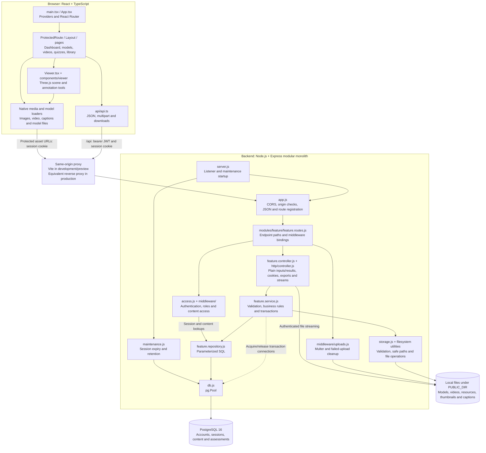

# AnatoLearn Technical Architecture

Implementation reference, updated 22 October 2026. Paths are relative to `anatolearn/` unless stated otherwise. This document describes implemented behavior; [PRD.md](PRD.md) remains the product requirements reference and [coding_guidelines.md](coding_guidelines.md) contains engineering constraints.

## 1. System overview

AnatoLearn combines a React learning/authoring interface, an Express API, PostgreSQL metadata, and locally stored teaching files. Students explore annotated models, watch videos, take assessments and open programme-specific resources. Teachers manage publication, programme assignment, download permissions, annotations, question banks and grading.

Arrows show calls and dependencies; responses return through the HTTP adapter and proxy. Feature modules cover auth, publicCatalog, catalog, models, annotations, videos, quizzes, assessments, questions, questionBank, resources, favorites and assets. Authentication and role/content guards apply according to each route; public auth/health/programme endpoints register before the global API gate. The assets service checks ownership and access before the adapter streams a file. Services manage transaction lifetimes and pass the same connection to transactional repository methods. Section 20 describes these boundaries in detail.

There is no public static teaching-file middleware. Vite's public directory is disabled so a production build does not copy uploaded files into its output; development filesystem deny rules also block alternate `/public` and `/@fs` paths to teaching files/backend configuration.

## 2. Stack and runtime

| Area | Manifest/configuration |
|---|---|
| UI | React / React DOM ^19.2.6, TypeScript ~6.0.2 |
| Navigation | react-router-dom ^7.17.0, BrowserRouter |
| Build | Vite ^8.0.12, React plugin ^6.0.1 |
| Styling | Tailwind ^3.4.19, PostCSS/Autoprefixer, Google Fonts |
| Rendering | Three.js ^0.184.0; OrbitControls, GLTFLoader, OBJLoader, USDLoader, DecalGeometry |
| Icons | lucide-react ^1.18.0; some SVG drawing/legacy icons remain |
| Backend | Node 22 containers, Express ^4.21.2, cors, dotenv |
| Authentication | jsonwebtoken ^9.0.2, bcryptjs ^2.4.3 |
| Persistence | PostgreSQL 16, pg ^8.13.1, Multer ^2.2.0, local files |

Versions are declared dependency ranges. `npm run build` runs TypeScript then Vite; `npm run lint` runs ESLint. Frontend tests are `test:viewer` and `test:models`; backend scripts are `test` and `test:integration`. TypeScript uses ES2023, bundler resolution and no emit; strict mode is not enabled.

## 3. Source responsibilities

| Path | Responsibility |
|---|---|
| src/main.tsx | React root, StrictMode and global CSS |
| src/App.tsx | provider composition and route tree |
| src/api/api.ts | same-origin JSON/multipart calls, bearer headers, selected-programme header, downloads and session-expiry notification |
| src/context/AppContext.tsx | identity/session, programme selection and theme provider |
| src/context/AppContextState.ts | AppContext definition, identity types and useAppContext hook |
| src/context/ToastContext.tsx / ToastContextState.ts | provider plus separate context/hook definitions for transient notifications |
| src/context/ConfirmContext.tsx / ConfirmContextState.ts | promise-based confirmation provider plus separate context/hook definitions |
| src/components/Layout.tsx | authenticated navigation, mobile menu, programme/theme/account controls and Outlet |
| src/components/ProtectedRoute.tsx | frontend token-presence guard |
| src/components/ContentSettings.tsx | teacher programme assignment, model download controls and quiz timer settings |
| src/components/QuestionBank.tsx | searchable bank, body-system category editing, import and removal |
| src/components/Dialog.tsx | dialog semantics, initial focus, focus trap, Escape and focus restoration |
| src/components/viewer/ | viewer overlays, data/editor hooks, sampling, serialization and projection helpers |
| src/types/anatomy.ts | shared model/annotation/payload/geometry types |
| backend/src/access.js | JWT extraction/verification and content policy predicates |
| backend/src/server.js | process startup, maintenance scheduling and backwards-compatible app export |
| backend/src/app.js | Express composition, CORS/origin/JSON middleware, ordered route registration and error handling |
| backend/src/modules/ | feature routes, controller bindings, business services and SQL repositories |
| backend/src/http/controller.js | request-to-input and result-to-response adapter, cookies, exports and file streams |
| backend/src/middleware/ | shared role gates, direct content/attempt authorization and Multer upload/cleanup |
| backend/src/assessments.js / quizQuestions.js / questionBank.js | compatibility exports for existing tests/tools; implementation lives in feature modules |
| backend/src/storage.js | local root/path resolution, model/resource validation and glTF reference checks |
| backend/src/db.js | dotenv configuration and pg.Pool |
| backend/sql/001..009 | initialization, seed data and additive schema changes |
| backend/tests/ | policy/integration tests and disposable browser-fixture tooling |
| tests/ | focused viewer-helper and model-parser regressions |
| docs/ | setup, API, database, storage, formats and verification records |

Provider components are separate from context/hook definitions so development hot reload does not replace a context while retaining consumers of the old object. These files share one context per concern. Pages consume contexts and the API client; they do not import other pages.

## 4. Routing and shell

Provider order is AppProvider -> ToastProvider -> ConfirmProvider -> BrowserRouter. Public routes sit outside Layout; protected routes share its navigation shell.

| Route | Component |
|---|---|
| / | redirect to /dashboard |
| /login, /register | Login, Register |
| /dashboard | Dashboard |
| /3dviewer | ModelGallery |
| /3dviewer/:modelId | Viewer |
| /videos | Videos |
| /videos/:videoId | VideoPlayer |
| /quizzes | Quizzes |
| /library | Library |

There are no role-specific frontend routes. ProtectedRoute checks token presence; the backend verifies JWT validity and authorizes content. A JSON API 401 clears stored frontend identity and notifies AppProvider, causing protected content to redirect to Login. There is no refresh-token flow.

Layout uses pathname equality or a child-path prefix for active navigation. A hamburger menu exposes all five sections below xl; account controls adapt to narrow widths. Shared Dialog wrappers trap keyboard focus, close through an explicit callback on Escape, and restore the invoking element's focus.

## 5. Identity, global state and session delivery

Registration accepts name, normalized email, password, student/teacher role and optional programme ID. It stores a bcrypt hash and returns an account, then the UI navigates to Login. Login returns `{ token, user }`; the JWT includes id, name, role, program_id and a UUID sid, with a 24-hour expiry. Teacher self-registration remains available; there is no invitation/approval workflow.

Login also sets `anatolearn_session`, an HttpOnly, SameSite=Lax cookie with a 24-hour maximum age and Secure in production. The cookie allows native image/video/document and model dependency requests to authenticate without URL tokens. API callers may use the Bearer header; it takes precedence over the cookie. Login persists sid in auth_sessions. Every authenticated request verifies the JWT and joins its unexpired, unrevoked session to the current users row, so backend permissions use current database identity. Logout revokes the presented session, clears the cookie and frontend session storage; copied bearer tokens for that session immediately fail. Tokens issued before migration 009 require a fresh login.

| State | Ownership/persistence |
|---|---|
| token/user | AppProvider; sessionStorage anatolearn_token / anatolearn_user |
| role | login response/stored user; development-only UI preview can change it |
| program | selected display name; sessionStorage anatolearn_program, synchronized to account programme when Layout initializes |
| theme | localStorage anatolearn_theme, initially OS preference or light; HTML root dark class |
| notifications | ToastProvider, three-second success/error queue |
| confirmation | ConfirmProvider, one pending choice |
| filters/forms/assessment/annotation UI | page-local state or viewer hooks |

The frontend still does not decode JWT claims. Identity for presentation comes from the login response; backend authorization uses the verified session and current database user. The development role preview never alters backend permissions. The viewer canvas background remains a separate local light/dark option.

## 6. Publication, programme and download policy

`canRead` allows teachers to inspect content and drafts across programmes. Students can read only published records whose program_id matches their authenticated account, or whose program_id is null (shared content). This policy applies to lists, direct model/video reads, annotations, quiz questions/start/submit and asset requests; it is not dependent on a client `published=true` parameter.

The API client sends the selected programme name in an encoded `X-Program-Name` header. List responses additionally filter to that programme plus shared records. A selector change reloads page lists and dashboard counts. Selecting another programme does not grant a student access beyond their account programme. Teachers can use ContentSettings to assign models, videos, quizzes and resources to a programme or to all programmes. Changing this assignment does not change the account's programme.

Models have `is_downloadable`, default false. The download endpoint requires both read access and the flag, for students and teachers. Gallery buttons reflect the permission and teachers can enable/disable it. Viewing and downloading are separate application permissions; allowing WebGL rendering necessarily delivers model bytes to an authenticated browser. This is not DRM and cannot prevent a viewer from extracting received bytes.

Attempt detail/answer reads require the owning student or a teacher. All student history queries use the authenticated user ID. Thumbnail writes are teacher-only. Student favourites accept only accessible content and reads exclude unpublished or other-programme records. Content-deletion triggers remove related favourite rows.

## 7. HTTP and asset delivery

API_BASE is `/api`; assets use relative same-origin paths. apiFetch includes credentials, Bearer headers and selected-programme headers, handles JSON/multipart content types, and surfaces backend messages. Downloads use authenticated blob fetches, Content-Disposition filenames, temporary object URLs and cleanup.

CORS allows configured FRONTEND_ORIGINS, credentials and Content-Disposition exposure. Unsafe requests with an untrusted Origin are rejected. Default development origins are localhost ports 5173 and 4173. Express 4 route registration wraps promise-returning handlers so failures reach the JSON error middleware; upload/validation failures return client errors, unexpected failures a generic 500.

Assets under /models, /videos, /resources and /thumbnails require authentication and a readable owning database record. Legacy glTF companions are permitted only when referenced by an accessible stored glTF model. Path resolution remains inside PUBLIC_DIR. Responses use private/no-store cache controls and nosniff; sendFile retains byte-range support for native media playback. There is no unrestricted static-file fallback.

## 8. Pages and teacher workflows

| Page | Implemented behavior |
|---|---|
| Dashboard | student attempt metrics, recent activity and favourites; teacher filtered content counts and management links |
| ModelGallery | 300ms debounced title/description/system/part search, metadata filters, keyboard-activatable cards, preview, upload/edit/publication/delete, download and annotation export; programme/download settings |
| Videos | local title search, playback, student favourites; teacher upload/edit/publication/delete, annotation linking and programme assignment |
| VideoPlayer | dedicated native player, MP4/WebM source types, visible loading failure |
| Quizzes | student timed/untimed attempts, scores, history and owned answer review; teacher authoring, question-bank copies, timer/programme settings, all student results and manual grading |
| Library | searchable PDF/document/photo/link resources; teacher upload/metadata editing/publication/delete/programme assignment; authenticated Open and external Visit |

Gallery cards support Enter/Space without intercepting nested controls. Headers and list rows wrap at narrow widths. Inputs and actions have shared focus-visible treatment. Some legacy viewer feedback still uses native alert dialogs; the application does not claim complete accessibility certification.

## 9. Viewer ownership and lifecycle

Viewer.tsx owns scene, camera, renderer, controls, source model/meshes, annotation markers, numbered sprite hotspots, hit targets and pending visuals through refs. React state holds annotations, interaction mode, selection, visibility and form/overlay state. No scene singleton or Three.js object is stored in React state.

| Module | Boundary |
|---|---|
| useViewerContent | route validation, model/video API data, stale-response protection, neutral-view persistence |
| useAnnotationEditor | draft/form state, save lock, create/update/delete calls, scene-epoch/mounted guards |
| ViewerOverlay / panels | presentational composition, list expansion, linked video and drag callbacks |
| drawingSamples / useDrawingSamples | plain screen/world/mesh-index samples and preview state |
| bindViewerEvents | DOM subscriptions and unsubscribe closure |
| annotationMapping | persisted/runtime kinds, payloads, draft defaults, identity matching |
| loadViewerAnnotations | ordered loading/render callbacks and newly generated cache persistence |
| basicAnnotationVisuals | plain descriptions for legacy/point visuals |
| projectedMaskData | camera snapshot, projector bounds and normalized mask data |
| projectedMask | alpha canvases, decal geometry/filtering/cache, painted-pixel hit testing and disposal |
| createAnnotationBadge | badge canvas; Viewer owns resulting sprite texture/material |

Projection helpers contain Three.js operations but no global scene state. Scene/resource ownership remains in Viewer; this differs from the older literal single-file guideline.

The lifecycle effect creates a 75-degree perspective camera, antialiased renderer with pixel ratio capped at 2, damped OrbitControls, ambient/directional lighting and the model loader. GLTFLoader handles GLB/glTF, OBJLoader handles OBJ and USDLoader handles USDZ. The model is framed or restored to its saved neutral view. Reset falls back to computed framing even if no neutral view has been saved. Only teachers generate missing thumbnails.

Drawing modes are view/point/highlight/region. Projection stores normalized mask points, projector orientation/position/size and the dominant source mesh. Decal geometry is filtered to the first visible surface, cached as arrays in JSONB and restored on reload. If filtering rejects every triangle, the helper retains the unfiltered fallback. Students can render old uncached annotations without attempting teacher-only cache writes.

Teachers can move an existing annotation by choosing Move and clicking a new surface position. The anchor and legacy geometry are translated; projected geometry is regenerated against the hit source mesh. Annotation IDs and video links remain intact. Stale save responses are ignored. Selection/hover reveals the corresponding visual; list items and numbered hotspots expose label identity and details/video actions.

Cleanup advances the scene epoch, cancels animation/thumbnail frames and region timers, unsubscribes events, clears hit targets/pending/annotation resources, disposes model geometry/materials/textures and controls/renderer, removes the canvas and clears refs. Late model loads dispose their results. The animation loop updates controls and renders without React state changes. Scene creation depends on model ID and file path. React Effect Events deliver current editor/role/visibility callbacks without recreating WebGL on UI changes or neutral-view saves. The effect-dependency warnings are resolved.

## 10. Assessments and question bank

Teachers configure an optional time_limit_seconds between 30 and 86400. Starting a student attempt creates a UUID quiz_sessions row with student/quiz IDs, server start/deadline and a complete question snapshot. The response omits answer keys. The timer UI corrects device-clock offset using server_now and counts down to the server deadline and automatically submits on expiry; the backend accepts a ten-second transport grace and rejects later submissions. Untimed sessions have a null assessment deadline but a separate session_expires_at lease, default 24 hours; timed sessions retain at least their deadline plus transport grace. Cancel/navigation closes the session through an authenticated keepalive request when possible.

Submission requires the owner's unused session and exactly one answer per snapshot question. Unknown/duplicate/missing questions and invalid MCQ options are rejected; unanswered questions are represented explicitly and score zero. A transaction locks the session, inserts the attempt and every answer, and consumes the session. Failures roll back everything; duplicate submission is rejected. MCQs grade immediately; open-ended questions set pending_review.

Manual grading accepts only open-ended answers with finite scores from 0 to 100. It locks the parent attempt, updates the answer and recalculates the overall question-weighted percentage in one transaction when all open-ended answers have scores. Student history/review uses owner-authorized endpoints. Teacher View Results lists both graded and pending attempts with student names.

Question mutations use a parent-quiz lock and transaction. Starting an assessment takes a shared parent lock while snapshotting, so concurrent edits cannot invalidate that snapshot. Quizzes with attempts or active sessions reject question edits/deletes/imports with 409; teachers create a new quiz for revised assessments. Quiz type is derived from its question formats.

The teacher-only question bank stores independent MCQ/open-ended questions with body-system categories. Teachers save existing quiz questions to the bank, search/edit/remove bank records and copy them into other quizzes. Editing/deleting a bank item does not change its previously imported quiz copies.

## 11. Database and migration history

| Table | Purpose |
|---|---|
| programs, users | programme names and hashed-password role accounts |
| models | paths, publication, programme/system/part, thumbnail, neutral view and download permission |
| annotations | model FK, point/highlight/region_fill type, text/color and geometry JSONB |
| videos | media path, publication/programme, optional annotation FK |
| quizzes, quiz_questions | assessment metadata/timer and per-quiz questions/category/answer keys |
| quiz_sessions | UUID, student/quiz, question snapshot, start/deadline/absolute lease/consumption |
| auth_sessions | UUID sid, user FK, expiry, revocation and creation timestamps |
| question_bank | independent reusable questions and body-system categories |
| quiz_attempts, quiz_attempt_answers | owner, score/status, responses and grading |
| resources | pdf/document/image/link, path or URL, publication/programme |
| downloads | best-effort authenticated model-download audit |
| favorites | unique user/type/item reference, cleaned by content-deletion triggers |

Shared types remain in src/types/anatomy.ts and are re-exported by components/viewer/types.ts. Runtime annotation kinds include point/draw/region/projectedDraw/projectedRegion; database kinds are point/highlight/region_fill. Projection cache, opacity and view data live in annotation_data JSONB.

Fresh PostgreSQL volumes run 001 schema, 002 seed, 003 users, 004 model metadata/download audit, 005 attempt owners, 006 video links, 007 favourites, 008 access/assessments and 009 session lifecycle. Existing volumes must apply additive scripts explicitly; 008 and 009 have been applied to the local development database. Do not rerun destructive 001/002 initialization scripts against existing content. Existing models begin with downloads disabled; existing quizzes remain untimed. The original seed dataset is unchanged and still differs from PRD prototype fixtures.

## 12. File storage and deployment

| Asset | Directory under PUBLIC_DIR | Upload support | Limit |
|---|---|---|---|
| Models | models/anatomy | GLB 2.0, embedded glTF 2.0, OBJ, USDZ | 200 MiB |
| Videos | videos | MP4/WebM | 200 MiB |
| Materials | resources | PDF, DOC/DOCX, PNG/JPEG/WebP; HTTP(S) links store URL | 50 MiB |
| Thumbnails | thumbnails/model-ID.png | teacher PNG-data submission | 10 MB JSON request limit |

Upload filenames use UUIDs. Model validation checks GLB structure headers, glTF version/embedded dependencies, OBJ vertices/faces or USDZ archive signature. Material validation checks selected type, extension and basic file signatures. Legacy local glTF companions can be served through ownership checks; new multi-file glTF uploads must be converted to GLB or embedded glTF. OBJ currently loads geometry without a companion MTL upload workflow. USDZ support depends on the installed USDLoader's format subset; Unreal .uasset is rejected with an export-to-GLB instruction. See 3d_model_tools.md.

storage.js centralizes the configured local root, safe resolution and validation, but Multer configuration lives in middleware/uploads.js and feature services coordinate local fs operations. A full cloud storage adapter is future work. Database deletion generally does not delete old uploaded files automatically; ops/Backup.ps1 creates consistent database-and-file snapshots and optionally verifies an isolated restore; orphan-file maintenance remains future work.

Compose runs PostgreSQL 16 and Node 22 frontend/backend development services on 5432/5173/5000. PUBLIC_DIR=/public points to the mounted frontend public directory; outside Docker the default is backend/public. The frontend uses BACKEND_URL=http://backend:5000; local Vite defaults to localhost:5000. Polling watch modes support Windows bind mounts. DATABASE_URL, JWT_SECRET, PORT and FRONTEND_ORIGINS configure backend behavior. Compose uses development credentials/secrets and no database readiness health check. The backend and frontend mount their source directories but keep an anonymous `/app/node_modules` volume, so dependency changes need `docker compose up -d --build --renew-anon-volumes`; the host `backend/node_modules` must be installed separately with `npm ci` for host-side runs.

Production must serve the SPA/build plus the same-origin authenticated API/asset routes, preserve Range and cookie headers, configure HTTPS/Secure cookies/origins/secrets, and never expose PUBLIC_DIR through a separate static server. Vite preview is a verification server, not the production deployment architecture.

## 13. Verification and remaining limits

Current checks include TypeScript/Vite build, ESLint, 26 viewer helper tests, two OBJ/USDZ parser tests and database-backed policy/assessment integration tests. Browser QA covers teacher/student flows, native media, OBJ viewing/label movement, permissions, programme filtering, timed MCQ submission/history/review and keyboard dialog behavior. Exact evidence, counts and scope are in testing_log.md.

The Viewer route is lazy-loaded: the current build separates a 374.66 kB initial JS bundle from a 754.28 kB viewer chunk. Remaining limits include the viewer chunk size warning, incomplete general API response typing, no exhaustive Chrome/Edge/Firefox/Safari sweep, no full four-programme browser matrix, no GPU/concurrency performance certification, no binary USDC/USDZ compatibility matrix, and legacy requirements such as embedded annotation exports/cloud adapters that are outside this change. Documented current behavior does not waive unmet PRD requirements.

## 14. Session maintenance and recovery operations

maintenance.js runs once at backend startup and hourly with an advisory transaction lock. It closes expired quiz sessions and removes closed quiz/auth sessions after 30 days. `QUIZ_SESSION_LIFETIME_HOURS` accepts 1–168 (default 24); `SESSION_RETENTION_DAYS` accepts 1–365 (default 30). `npm run maintenance` runs the same job manually. Quiz attempts and answers are retained independently. Active question-edit guards include the ten-second submission grace.

`ops/Backup.ps1 -VerifyRestore` pauses the running backend, creates a PostgreSQL custom dump plus teaching-assets tar archive, hashes and row-count manifest, and restarts the backend in a finally block. The optional verification creates a fresh database and separate extracted asset directory; it never replaces live data. The Compose operations profile uses the PostgreSQL tools image with read-only source assets. Backups are ignored by Git and Docker builds and denied by Vite. See README.md for operation and recovery limitations.

22 October follow-up verification: both roles across five pages at 375/768/1440 in in-app Chromium; assigned/shared content enforced through actual API accounts for all four programmes; timed quiz browser submission; revoked-session and expired-session regressions; successful database/file restore with hash and row-count equality. Other browser engines and the complete programme-by-browser matrix remain unverified.

## 15. Viewer reliability follow-up — 22 October 2026

The resource effect is keyed by model ID/file path. Effect Events separate long-lived scene subscriptions from current UI callbacks. Epoch checks reject late model/annotation/editor/move/delete responses after teardown; editor reset invalidates older save completions. Saving a neutral view updates metadata without recreating the scene. Moving annotations temporarily disables conflicting authoring actions.

Canvas picking checks numbered sprites and painted mask hit targets before annotation visuals. Hidden annotations cannot be selected from the canvas. Orbit/pan drags are distinguished from deliberate clicks. Drawing tracks a primary pointer with capture, handles cancellation/lost capture/window blur and clears preview state on teardown. Straight or nearly collinear region gestures are rejected instead of storing invisible fills.

Container ResizeObserver updates the camera and renderer alongside the window resize listener. Default framing fits the bounding sphere to the narrower horizontal/vertical field of view and scales clipping/distance limits to model size. Explicit camera reset consumes residual OrbitControls damping before applying the pose; focusing an annotation retains the requested target. Saved teacher neutral views remain explicit camera poses.

Cleanup additionally releases decoded ImageBitmaps and skinned-model skeleton buffers, deduplicating shared resources, and explicitly releases the WebGL context after renderer disposal. Thumbnail capture occurs after the animation loop's render. Empty models/WebGL creation failures show visible errors; model/annotation loading has status feedback and disables authoring until ready. Annotation validation/save failures are inline; neutral-view/delete/projection feedback uses accessible toasts.

Numeric framing and annotation-translation helpers own no scene state. A disposable backend/tests/viewer-fixture.js supplies embedded checker-textured glTF with transformed meshes, an OBJ comparison, stored region, linked video and two roles. All generated records/files were cleaned after verification. See testing_log.md for actual browser coverage and limits.

## 16. Accessibility and request-state follow-up — 22 October 2026

`hooks/useResource.ts` owns page-local asynchronous read state, manual reload and optional programme scope. Stable loaders are supplied with useCallback; effect cleanup ignores late responses, and a loader/scope/revision mismatch hides stale data immediately. The empty/reset value is stable for the resource lifetime. Data stays local to the page; no additional global context was introduced. Main lists, dashboard data, quiz history/favourites, video favourites/link choices, programme choices, question bank and video metadata use this boundary. Mutations keep their existing endpoints and update/reload the relevant local data.

`components/RequestState.tsx` separates loading status, persistent read failures with manual Try again, and successful empty content. Retry never replays a mutation. After a retry, keyboard focus returns to the main/dialog region on success or to the retry control on failure. Failed dashboard reads show unavailable values instead of misleading zero counts; failed lists do not claim there is no content. Quiz draft finalization/discard failures keep the editor open with the error.

The API client shares response handling for JSON and binary requests. ApiError carries a client-side status, preserves useful 4xx validation messages, gives readable network/5xx/invalid-JSON messages and expires stored identity for protected 401s, including downloads. Authentication failures do not clear an existing session automatically; Login distinguishes invalid credentials from service failures.

Dialog applies reference-counted inert state to background DOM branches and locks body scrolling, restoring original state when the last relevant modal closes. It retains focus trapping, Escape callbacks, heading association and connected-trigger focus restoration. Layout supplies skip-to-main, route-change focus, current-page semantics and an Escape-closeable mobile navigation region with a stable controls target. Form labels/control names, pressed states and announced errors are explicit; global focus rings include custom focusable cards, inputs and textareas. Reduced-motion preferences suppress decorative animation/transitions.

This pass improves usability without claiming WCAG certification. Real screen-reader, contrast, captions/transcripts and complete cross-browser accessibility verification remain open. Backend routes, schema, storage formats and account access policies are unchanged.

## 17. Screen-reader semantics and compatibility evidence — 22 October 2026

`RouteAnnouncement` stays mounted inside BrowserRouter. It supplies page-specific document titles and a polite, atomic status region for SPA navigation, including auth and model/video detail pages. Layout retains its route-change main focus behavior. Login and Register expose named main landmarks; the registration password requirement is associated through aria-describedby. The annotation list exposes expanded and pressed states, and the selected annotation details are a named region available independently of the WebGL canvas.

New checks passed in the connected in-app Chromium browser: login/register titles and landmarks, authenticated dashboard/viewer titles, keyboard annotation selection, selected state, named details region and collapse state. Build and lint passed. These are accessibility-tree/DOM/keyboard checks, not spoken-output verification. Windows Chrome and Edge exist but are not connected to the browser-control interface; Firefox and NVDA were not found in their checked standard installation paths. Native app control is unavailable in this session. Safari requires a supported Apple environment. Consequently real screen-reader and four-browser acceptance remain pending, with concrete procedures and evidence requirements in accessibility_compatibility.md. No requirement has been removed or marked passed without execution.

## 18. Automated browser and accessibility verification — 22 October 2026

`playwright.config.mjs` defines installed stable Chrome/Edge channels plus downloaded Playwright Firefox/WebKit projects. The host runs the suite against the local Docker app with one worker. `tests/browser/setup.mjs` creates disposable role/content fixtures; teardown verifies the run's ownership stamp before removal. Backend fixture setup now refuses an existing manifest, and optional cleanup stamps prevent deleting another run's fixture. No production schema, seed or endpoint changed.

`tests/browser/accessibility.spec.mjs` combines actual UI workflows with axe WCAG 2 A/AA and 2.1 A/AA tagged audits. It checks public auth, both roles across five sections in light/dark themes, keyboard dialog isolation/return focus, compact navigation and skip-to-main, viewer geometry/annotation/video feedback, MP4 playback where supported, keyboard MCQ submission/results and read-error recovery. Browser binaries, temporary identities and raw reports/traces are ignored by Git/Docker, excluded from ESLint and Vite polling, and blocked by Vite's file-serving deny rules. `test:browser:summary` exports sanitized outcomes and manual-review rule IDs; raw reports remain private local artifacts.

Axe identified low-contrast secondary text; the shared slate-400/dark-slate-500 usage was strengthened to slate-600/dark-slate-400 in affected pages/viewer panels. WebKit keyboard testing identified the skip link's need for explicit tabindex=0. The suite waits for the actual dashboard render before starting keyboard checks and invokes modal/quiz actions through keyboard events. Downloaded browser/report directories initially overwhelmed the Windows bind-mounted polling watcher; explicit watch exclusions removed that QA-induced slowdown. Viewer readiness has a bounded 45-second test wait, not a performance guarantee.

Windows Playwright WebKit rejected the fixture's H.264 Main/AAC LC MP4 with NotSupportedError, despite authenticated HTTP 206 delivery. The viewer's visible media-error path is tested there; the separate playback test is explicitly skipped on Windows WebKit. Actual Safari/macOS playback and spoken NVDA/VoiceOver behavior remain unverified. This supersedes the earlier lack of automated browser-engine access; it does not waive PRD NFR-17 or constitute WCAG certification. Dated outcomes are in testing_log.md and verification/browser-accessibility-summary.json.

## 19. English WebVTT caption tracks — 22 October 2026

Migration `backend/sql/010_video_captions.sql` adds nullable `videos.captions_path`. Teachers can attach an optional `.vtt` at video creation, replace it through `POST /api/videos/:id/captions`, or remove it with `DELETE /api/videos/:id/captions`. Server validation requires UTF-8 WebVTT with a `WEBVTT` header and a 2 MiB maximum. Files use UUID names under `PUBLIC_DIR/captions/`; validation or database failure removes newly uploaded files.

The authenticated `/captions/*` asset handler resolves caption ownership to the video row and reuses its programme/publication access policy. Vite proxies that route to the backend; production must do the same and must not publish the storage directory as static content. Standalone and viewer-modal players render a default native English captions track when a path exists. Captions are optional, manually supplied by teachers and English-only; the app does not transcribe or verify them. Unit and database integration coverage includes valid/malformed VTT, authenticated delivery, programme denial, teacher replacement and removal. Fresh cross-browser caption-track coverage is being rerun; actual Safari and spoken screen-reader checks remain environment-dependent.

Dependency audit follow-up: Tailwind CSS v4 now runs through the official Vite plugin with the existing JavaScript config explicitly loaded. Compatible frontend advisories were patched; Nodemon was removed in favor of Node 22 `--watch` because its legacy dependency chain had no safe release. Both frontend and backend `npm audit` report zero vulnerabilities. Build/lint and backend tests pass; the existing Viewer bundle-size warning remains.

## 20. Layered feature modules — 22 October 2026

The backend is a layered modular monolith. The React presentation tier and PostgreSQL/file persistence tier remain unchanged. All existing feature endpoints now follow:

~~~text
React API client
  -> feature routes (paths, role/auth/upload middleware)
  -> feature controller (shared HTTP adapter)
  -> feature service (validation, permissions, workflow, transactions)
  -> feature repository (parameterized SQL)
  -> PostgreSQL
~~~

Feature directories under backend/src/modules are auth, models, annotations, videos, quizzes, assessments, questions, questionBank, resources, favorites, assets, catalog and publicCatalog. Each has matching .routes.js, .controller.js, .service.js and .repository.js files. publicCatalog contains public health/programme reads; catalog contains cross-content programme assignment and shared list filtering. Existing assessment/question-bank entry files are compatibility shims, not duplicate implementations.

Controllers bind named service operations through http/controller.js. The adapter passes a plain input record (body, params, query, user, headers, path and uploaded-file descriptors), rather than live Express objects. Services return plain result records with status, kind, body and optional headers/cookies/file information. The adapter applies those results to Express, including JSON/CSV exports, cookies, sendFile and download error callbacks. This intentionally keeps the existing HTTP result contract in the application layer; it is not a completely transport-independent domain model. SQL lives in repositories, while services own transaction connection lifetimes, locks, commit/rollback decisions and release. There is no ORM or new runtime dependency.

Authentication/token extraction and shared read/download predicates remain in access.js; its live-session lookup delegates to auth.repository.js. middleware/contentAccess.js delegates content/attempt lookups to catalog.repository.js. middleware/roles.js owns teacher/student gates. middleware/uploads.js owns Multer disk configuration and failed-response cleanup. storage.js retains file validation/path/dependency utilities. Services still coordinate filesystem effects directly; a cloud storage adapter and a separate domain/entity model remain future work. Operational maintenance remains in maintenance.js with its existing SQL.

Public routes register before the /api authentication/content gate. All other features register after it, and file routes explicitly authenticate. Existing route paths, payloads, status codes, role/programme/download policies, cookie behavior, quiz transaction semantics and database schema are preserved. server.js remains the npm/Docker entry point and starts maintenance only when executed directly; importing app.js or server.js does not open a listener or schedule maintenance. No frontend migration or database migration is required.

Verification for this refactor is recorded in testing_log.md. Existing product gaps and browser/accessibility limitations elsewhere in this document remain applicable.

## 21. Administrator role — 23 October 2026

`user_role` gains `admin` (`backend/sql/015_admin_role.sql`). `requireAdmin` in `middleware/roles.js` now guards every `/api/users` route and `/api/audit-log`; teachers receive 403. `users.service` accepts `student`, `teacher` or `admin`, refuses self-demotion/disabling of an admin, and keeps at least one active administrator (the same guard protects self-deletion in `profile.service`). `GET /api/dashboard` returns `{ role: 'admin' }`. Public registration still allows only student/teacher; administrators are created with `backend/scripts/create-admin.js` (creates or promotes by email) or by another administrator under Users.

The frontend `Role` type includes `admin`. `ProtectedRoute` accepts one role or a list and sends other roles to their own home (`/admin/users` for administrators, `/dashboard` otherwise). Learning routes (dashboard, 3D viewer, videos, quizzes, library, search, announcements) are limited to students and teachers; `/profile` is open to all roles and `/admin/users` is admin-only. For administrators `Layout` shows only the Users link, hides search, the programme selector and the announcements bell, and `Breadcrumbs` has no dashboard root. The teacher dashboard no longer links to Users. The integration suites set `DISABLE_RATE_LIMIT=true` in-process because they sign in more often than the 10-per-15-minute login limit allows. Remaining gaps: administrators cannot see learning content, and there is no in-app way to create the very first administrator; use the script.
